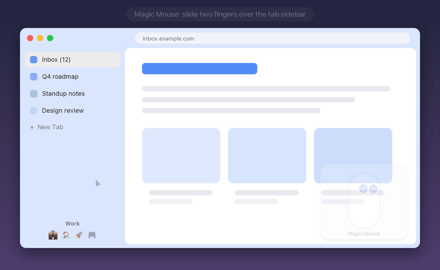
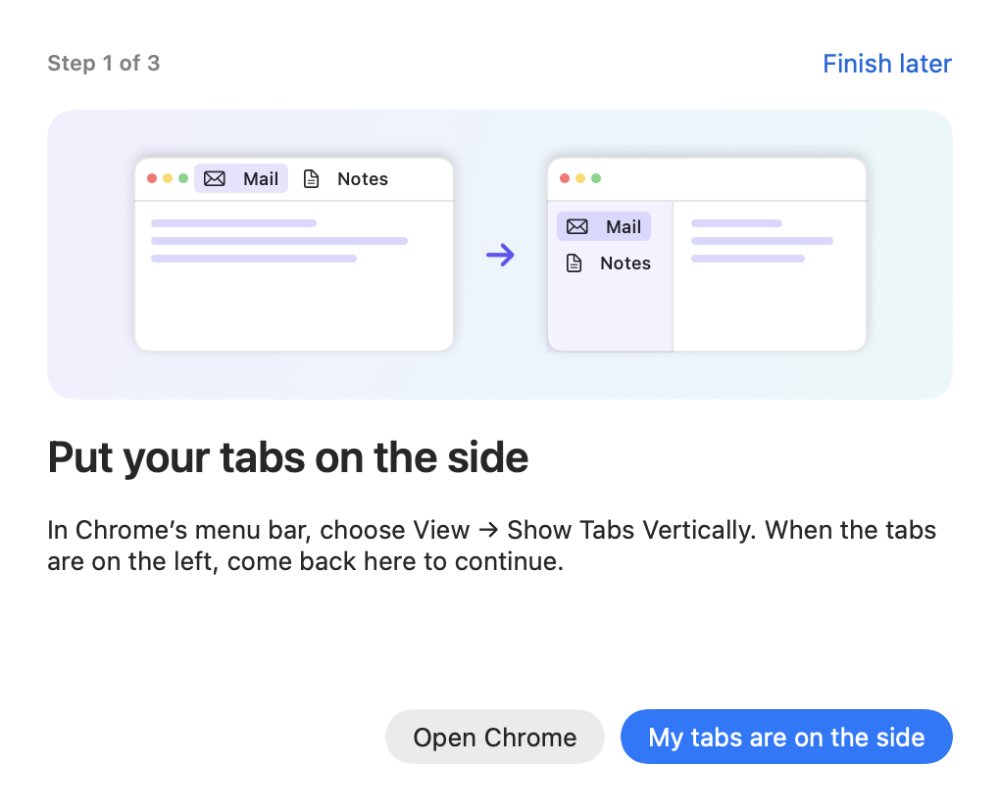

# ProfileSlide

**Arc is dead. ProfileSlide brings smooth profile switching to Chrome: keyboard shortcuts and mouse slides.**



## Give this to your agent

Paste this prompt into Claude Code, Codex, or another coding agent on your Mac.

```text
Install ProfileSlide (https://github.com/jmitchel3/profileslide) on my Mac.
Check for macOS 26+, Google Chrome, and the Xcode command line tools. Clone the repo,
run ./build.sh, copy build/ProfileSlide.app to /Applications, and open the installed app.
Walk me through the three screens in the app’s illustrated setup guide.
If I dismiss it, I can resume anytime in Settings > Show Setup Guide.

1. Start with Chrome’s tabs. Ask me to open Chrome and choose View > Show Tabs Vertically.
   If the tabs are already on the left, I can continue. Wait until I confirm the sidebar is visible.
2. Explain that ProfileSlide needs Accessibility to recognize swipes and bring Chrome windows
   forward. Have me enable ProfileSlide in System Settings > Privacy & Security > Accessibility.
   The guide advances when macOS grants access. If access is already allowed, choose Continue.
3. Help me switch to another Chrome profile. Swipe sideways over the tab sidebar.
   If the other profile is closed, choose Open when prompted. If I have
   only one profile, show me Chrome’s profile icon > Add Chrome profile, or let me finish later.
   Wait until I see the other profile’s window.

After the switch, show me how to reopen Settings by right-clicking the dots or launching
ProfileSlide again. Offer to customize my emoji, profile order, and hidden profiles. If I
want changes, read ~/Library/Application Support/ProfileSlide/config.json, list my profiles,
and preserve my other settings when saving my choices.
```

## What it does

Arc-style space switching for Google Chrome on macOS. Swipe sideways with two fingers (trackpad or Magic Mouse) on Chrome's vertical tab sidebar to move between Chrome profiles. A row of profile icons sits at the bottom of the sidebar, like Arc's space dots.

- Swipe left or right on the sidebar to select the next or previous profile in dot order, with live swipe feedback, trackpad haptics, and a frosted-glass profile switch HUD. Open profiles come forward immediately. For a closed profile, choose **Open** or press Return to open it, press Esc to cancel, or swipe again to keep browsing (or turn off confirmation to open immediately).
- **Unified Window Mode**: switching to another open profile on the same display automatically aligns its window frame to the current window so Chrome feels like one single browser with Arc spaces.
- **Interactive profile dots** at the bottom of the sidebar tracked in real time via `AXObserver`: hover to preview name and shortcut, click to jump/open, **⌥-click** to move the current tab to that profile, or right-click to switch, move tabs, or **Sleep** (save tabs & close window to free RAM).
- **Keyboard shortcuts & Quick Switcher**: `⌃1`–`⌃9` jump directly, `⌃←`/`⌃→` cycle adjacent profiles, `⌃Space` opens the fuzzy-search Quick Switcher inside Chrome, and `⌥⌃Space` opens it globally from any app (`↩` switch, `⇧↩` move current tab, `⌘W` sleep profile).
- **Optional menu bar companion**: jump to any Chrome profile, move the active tab, or sleep open profiles from any app (off by default; enable in Settings).
- An emoji per profile, custom order, swipe sensitivity & reverse direction, and hide profiles you don't use.
- Per profile, choose what it opens with when it has no window: a new tab, its last session, or a fixed list of pages (fill it from the current tabs or the profile's top sites). Sleeping a profile saves its tabs for a one-time restore the next time you wake it.

## Privacy

Everything stays on your Mac; the app makes no network requests. It reads Chrome window titles (Accessibility) to tell profiles apart, a profile's Top Sites and History databases only when you pick from "Add Top Site", and tab URLs (through Chrome's AppleScript, which asks for Automation permission) only when a profile uses Last Session or you press Use Current Tabs / Save Now. Saved sessions live in `~/Library/Application Support/ProfileSlide/sessions.json`.

## Requirements

- macOS 26 or later
- Google Chrome (the setup guide shows how to turn on vertical tabs)
- Xcode command line tools (`xcode-select --install`) to build

## Build and run

The [GitHub release](https://github.com/jmitchel3/profileslide/releases/latest) includes a locally signed, unnotarized app for Apple silicon on macOS 26 or later. To build from source, run these commands on your Mac.

```sh
./build.sh
open build/ProfileSlide.app
```

The first launch opens an illustrated guide.



1. In Chrome, choose **View → Show Tabs Vertically**. Return to ProfileSlide and select **My tabs are on the side**. [Chrome’s vertical tabs guide](https://support.google.com/chrome/answer/2391819?hl=en)
2. Choose **Open Accessibility Settings** and turn on **ProfileSlide**. If access is already allowed, choose **Continue**.
3. Swipe sideways over the sidebar. If the profile is closed, choose **Open** when prompted. You can also click a dimmed dot to open that profile directly. If you have one profile, use Chrome’s profile icon to add a second. [Chrome’s profiles guide](https://support.google.com/chrome/answer/2364824?hl=en)

The guide appears automatically once. **Finish later**, Esc, or closing the window saves your place. Open **Settings → Show Setup Guide…** to resume. Once you switch profiles successfully, the guide closes and the same Settings button lets you replay it.

To keep the permission across rebuilds, sign with a stable identity. `build.sh` uses a local self-signed identity in `~/Library/Application Support/ProfileSlide/signing/signing.keychain-db` if one exists, and otherwise falls back to ad-hoc signing (macOS then asks again after each rebuild).

## Settings

After closing the guide, reopen the running app from Spotlight or Finder to see Settings, or right-click the profile dots and choose **Settings…**. While Setup or Settings is open the app has a Dock icon. Close the windows or press ⌘Q to return it to the background. **Quit Completely** (or ⌥⌘Q) stops it.

Settings are stored in `~/Library/Application Support/ProfileSlide/config.json`:

```json
{
  "controlNumberShortcuts": true,
  "profiles": [
    { "dir": "Default", "emoji": "🎮", "hidden": false },
    { "dir": "Profile 2", "emoji": "💼", "hidden": false }
  ]
}
```

`dir` is Chrome’s profile directory. It stays the same when you rename a profile. Older entries using `match` still work when the email or profile name identifies one profile. Settings writes directory IDs on the next save. The list order is the dot and swipe order. Profiles not listed follow in Chrome's order. An empty `emoji` draws a dot in the profile's theme color.

Logs: `~/Library/Logs/ProfileSlide/poc.log`.

## How it works

- A session event tap watches scroll gestures. It only acts when Chrome is frontmost and the gesture starts over Chrome's vertical tab strip, which Chrome exposes to the Accessibility API as a tall `AXTabGroup`. Its live frame is used, so resizing the sidebar just works.
- Chrome suffixes window titles with the profile name when more than one profile exists. That maps windows to profiles listed in Chrome's `Local State` file.
- Profile colors come from each profile's theme in its `Preferences` file.
- The dots are a borderless, non-activating panel positioned over the bottom of the sidebar.

## Versioning

Each change that lands on `main` increments the patch version and build number and adds an entry to the [changelog](CHANGELOG.md). Use a descriptive PR title when squash-merging, or a descriptive commit subject when pushing directly. `build.sh` reads both version numbers from `version.json`.

To enable automatic pushes in a development clone, run `git config --local core.hooksPath .githooks` once. Committing on `main` then pushes the change to `origin/main` and waits briefly for GitHub’s version and changelog commit so the next change starts from that version.

## License

MIT
